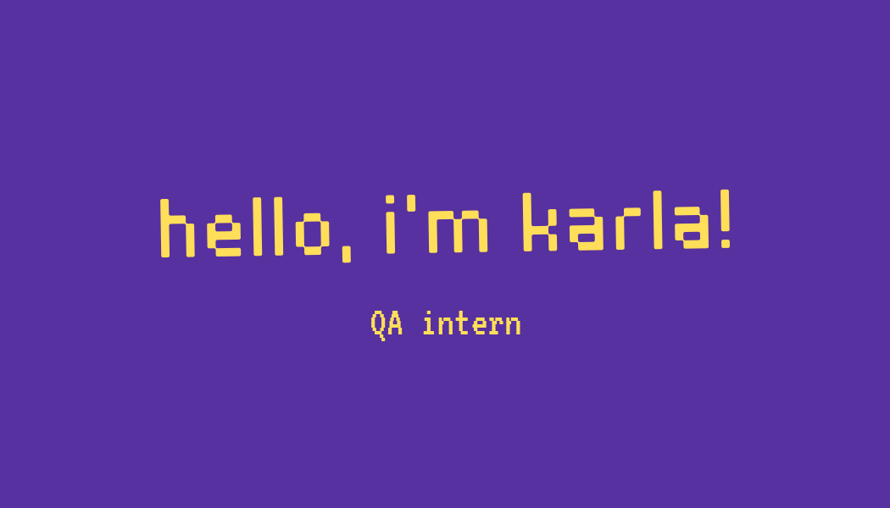

<h1 align="center"> 👋 </h1>

  

<strong>Intern @ BlueShirts Solutions</strong>

<h2 align="center"> 👩‍💻 Who am I</h2>

  <samp>Hi, I'm Karla! A Computer Science student and aspiring QA Automation Engineer, currently an intern at BlueShirts Solutions. With hands-on experience turning messy workflows into clean, repeatable systems using Make.com, Notion, and Google Sheets, I bring a detail-oriented, structured approach to manual testing and bug tracking.
  </samp>
     
  

<h2 align="center"> 🔭 Tools of Trade</h2>

  &nbsp;&nbsp;
  &nbsp;&nbsp;
  &nbsp;&nbsp;
  &nbsp;&nbsp;
  

  &nbsp;&nbsp;
  &nbsp;&nbsp;
  &nbsp;&nbsp;
  

  &nbsp;&nbsp;
  &nbsp;&nbsp;
  &nbsp;&nbsp;
  

<h2 align="center"> 🌱 Currently Learning</h2>

  &nbsp;&nbsp;
  &nbsp;&nbsp;
  &nbsp;&nbsp;
  

  &nbsp;&nbsp;
  

  

<samp>PS. I literally just wanted to understand Aimyon and Vaundy's songs lol</samp>

<h2 align="center"> 🧠 Soft Skills</h2>

  <samp>Process Thinking · Client Communication · Systems Debugging · Attention to Detail · Self-Directed Learning</samp>

